<div align="center">

# DISCRETA

**A Classical Cryptography and Frequency Analysis Laboratory**

Encrypt with Caesar, affine and Vigenère ciphers, then break them with the statistics a cryptanalyst would use:
letter frequencies, χ², the index of coincidence and Kasiski examination.

<p>


</p>

<picture>
  <source media="(prefers-color-scheme: dark)" srcset="docs/report/screenshots-v1.0.0/workspace-vigenere-encrypt-dark-1440.png">
  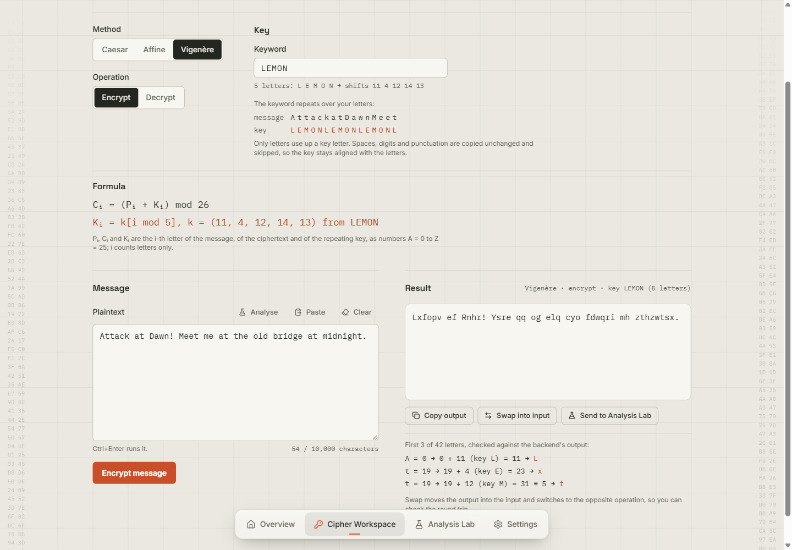
</picture>

<sub>Team **BugSquad** (Samudra Kar and Shriyanshu Rout Roy) · Version 1.0.0 · [Documentation](docs/README.md) · [Project report](docs/report/PROJECT_REPORT.md) · [API](docs/api.md)</sub>

</div>

---

## Contents

[Overview](#overview) · [Core features](#core-features) · [Supported ciphers](#supported-ciphers) · [Analysis capabilities](#analysis-capabilities) · [Interface tour](#interface-tour) · [Architecture](#architecture) · [Technology stack](#technology-stack) · [Worked examples](#worked-examples) · [Mathematical foundations](#mathematical-foundations) · [Installation](#installation) · [Running locally](#running-locally) · [Testing](#testing) · [Documentation](#documentation) · [Limitations and disclaimer](#limitations-and-security-disclaimer) · [Team](#team-bugsquad)

## Overview

Classical ciphers are usually taught on paper, where the arithmetic is tedious and the attacks are hard to see working.
DISCRETA puts both in one place. The **Cipher Workspace** encrypts and decrypts, showing the one formula that applies to your
key and the first steps worked out and checked against the backend. The **Analysis Lab** takes a ciphertext and measures it:
counts its letters against English, ranks every possible Caesar and affine key, and investigates the key length of a Vigenère
cipher. A result moves from one to the other without retyping.

The mathematics is discrete mathematics (modular arithmetic over ℤ₂₆, the Euclidean algorithm, modular inverses, probability),
and **the backend is the only place that does any of it**: the frontend validates input, calls the API and presents the reply.
Every analysis is labelled for what it is: *measured* (counted from your text), *calculated* (derived by a formula) or a
*suggestion* (an estimate, never proof).

## Core features

* **Three ciphers**, each with encryption and decryption, strict key validation and one uniform error format.
* **Frequency analysis** with an English reference, a χ² score and the index of coincidence.
* **Caesar and affine key ranking** over all 26 and all 312 valid keys, with reliability flags for short text.
* **Vigenère investigation**: index of coincidence, Kasiski examination, key-length ranking, per-position key letters and
  ranked candidate keys.
* **A connected workflow**: send a result to the Analysis Lab, inspect candidates, send one back to test it.
* **Floating glass taskbar** as the only navigation; light, dark and system themes; keyboard accessible; responsive from 375 px.
* **Verified mathematics**: textbook vectors, brute-force definitions and independent reference implementations.

## Supported ciphers

| Cipher | Encryption | Decryption | Key space |
| --- | --- | --- | --- |
| Caesar | E(x) = (x + k) mod 26 | D(y) = (y − k) mod 26 | 26 keys |
| Affine | E(x) = (a·x + b) mod 26 | D(y) = a⁻¹(y − b) mod 26, gcd(a, 26) = 1 | 12 multipliers × 26 offsets = 312 keys |
| Vigenère | Cᵢ = (Pᵢ + Kᵢ) mod 26 | Pᵢ = (Cᵢ − Kᵢ + 26) mod 26 | 26ᵐ for a keyword of m letters (1 to 64) |

Only ASCII letters are enciphered and case is kept; spaces, digits, punctuation and non-ASCII characters are copied unchanged,
and for Vigenère they do not use up a key letter.

## Analysis capabilities

| Analysis | What it reports | Kind |
| --- | --- | --- |
| Letter frequencies | counts, shares, ranks, difference from English | measured |
| χ² statistic | Σ (Oᵢ − Eᵢ)² / Eᵢ against English, per letter and in total | calculated |
| Caesar ranking | all 26 shifts ranked by χ², each decryption | suggestion |
| Affine ranking | all 312 valid keys ranked by χ², modular inverses | suggestion |
| Index of coincidence | IC = Σ fᵢ(fᵢ − 1) / (N(N − 1)), a reading, Friedman's estimate | measured, calculated |
| Kasiski examination | repeated sequences, positions, distances, key-length votes | measured |
| Vigenère key length | mean column IC for lengths 1 to 20, a suggested length | calculated, suggestion |
| Vigenère key letters | χ² per column, up to ten ranked candidate keys | suggestion |

## Interface tour

The application has four destinations, reached from the floating taskbar: **Overview**, **Cipher Workspace**, **Analysis Lab**
and **Settings**. All images are the running application against the real backend.

<table>
<tr>
<td width="50%">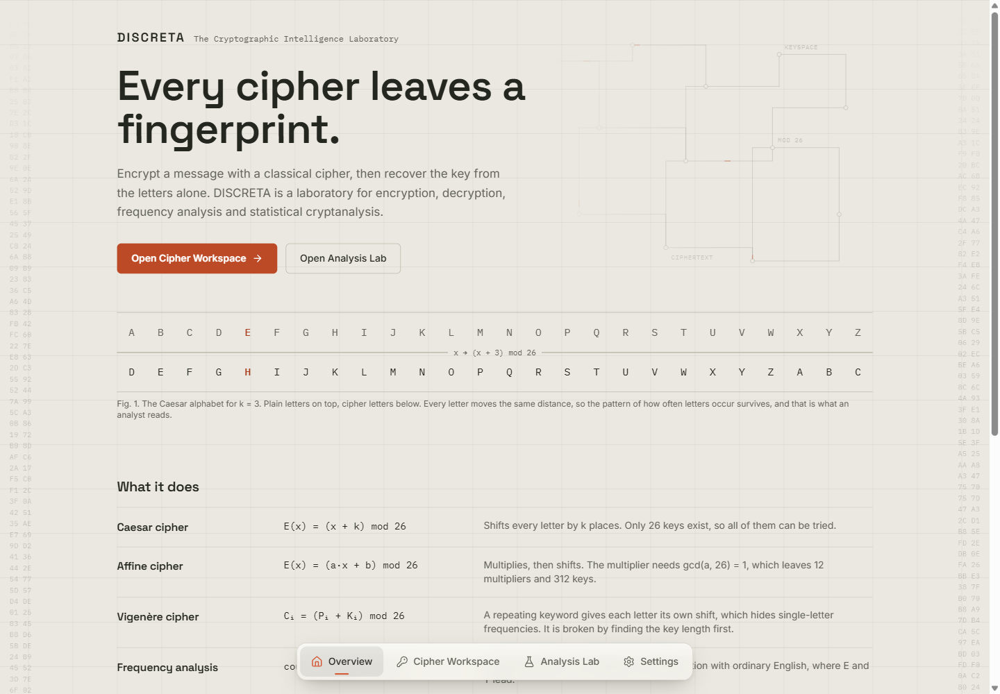<br><sub><b>Overview</b> · light theme</sub></td>
<td width="50%">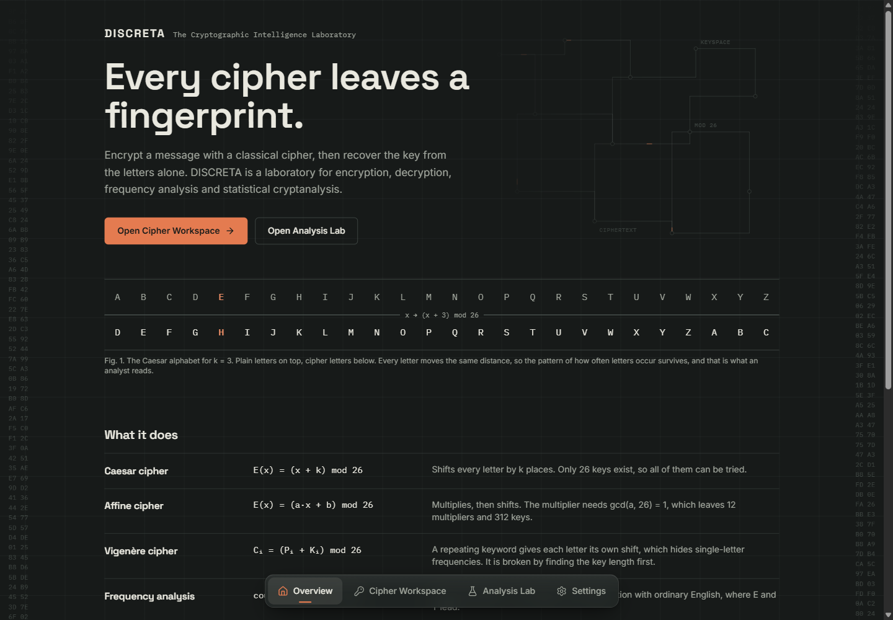<br><sub><b>Overview</b> · dark theme</sub></td>
</tr>
<tr>
<td>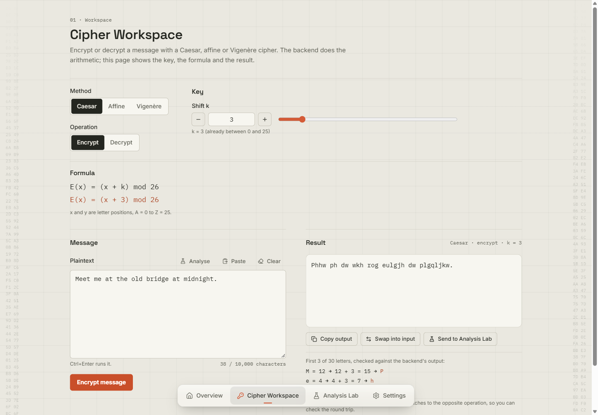<br><sub><b>Caesar</b> · encrypt</sub></td>
<td>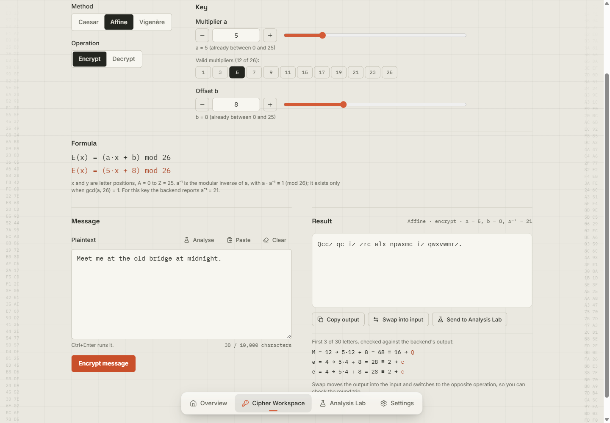<br><sub><b>Affine</b> · encrypt, valid multipliers</sub></td>
</tr>
<tr>
<td>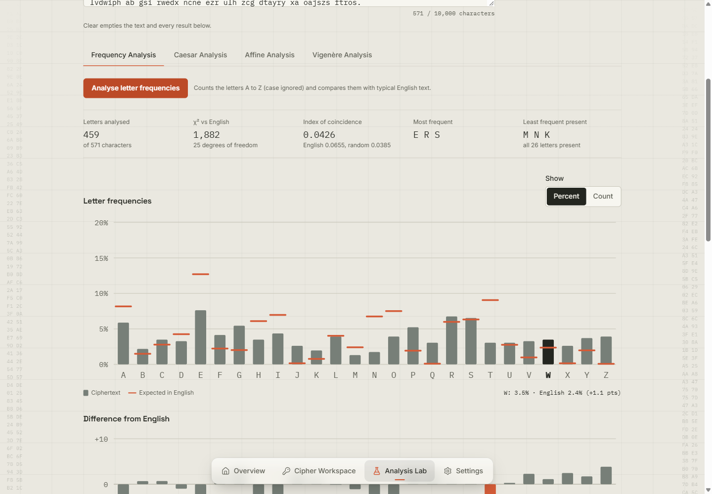<br><sub><b>Frequency analysis</b> · counts against English</sub></td>
<td>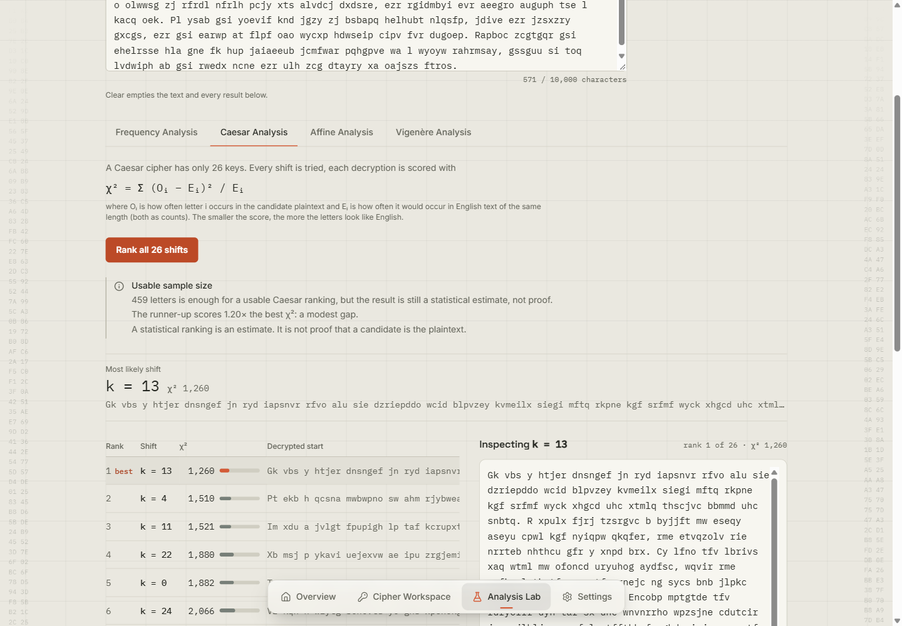<br><sub><b>Caesar analysis</b> · 26 ranked shifts</sub></td>
</tr>
<tr>
<td>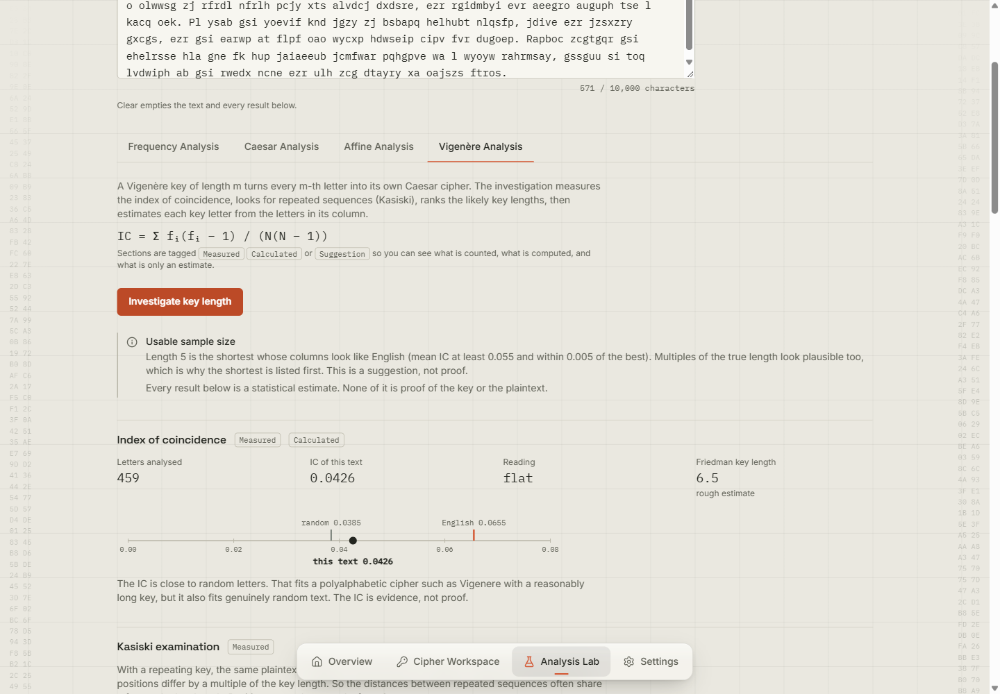<br><sub><b>Vigenère</b> · index of coincidence</sub></td>
<td>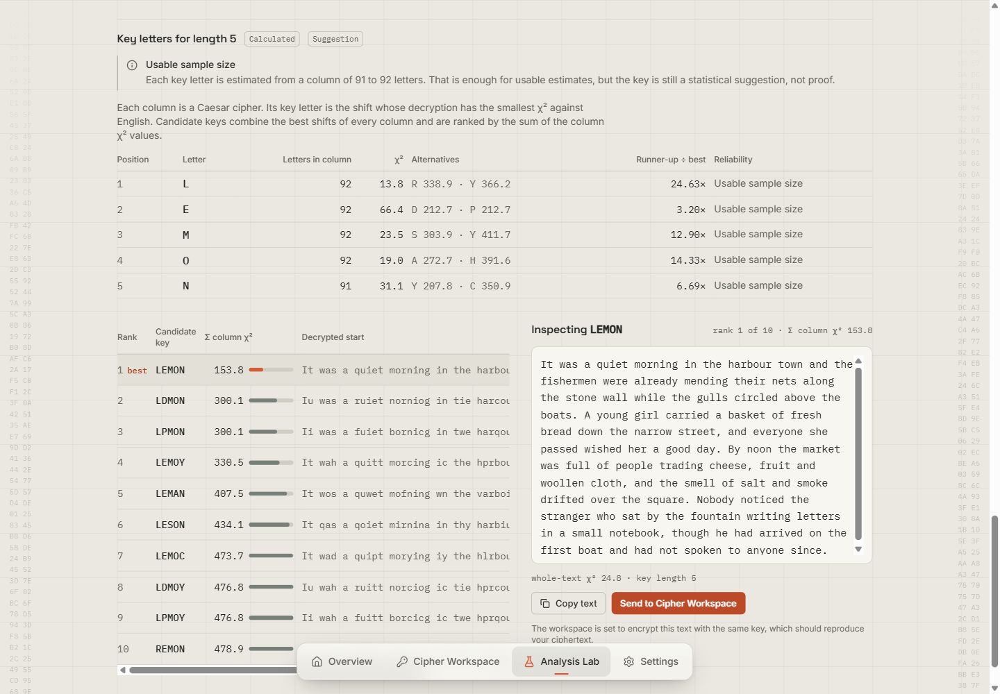<br><sub><b>Vigenère</b> · key letters and candidates</sub></td>
</tr>
</table>

More in [`docs/report/screenshots-v1.0.0/`](docs/report/screenshots-v1.0.0/): decryption for all three ciphers, the affine ranking, the Kasiski
and key-length views, Settings, and the mobile layout with the taskbar.

<table>
<tr>
<td width="33%">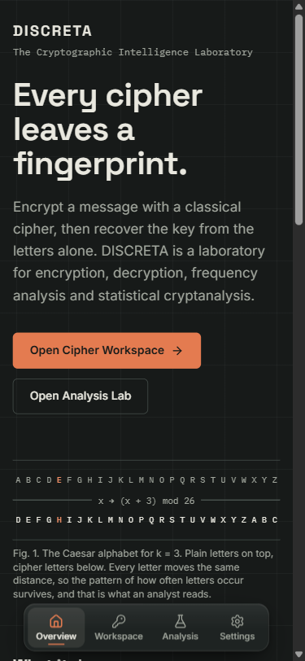</td>
<td width="33%">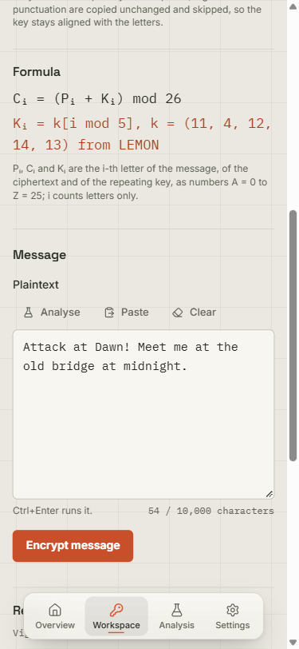</td>
<td width="33%">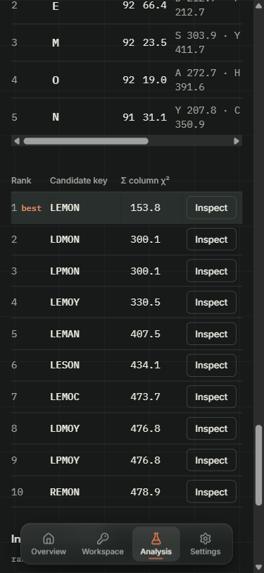</td>
</tr>
</table>

## Architecture

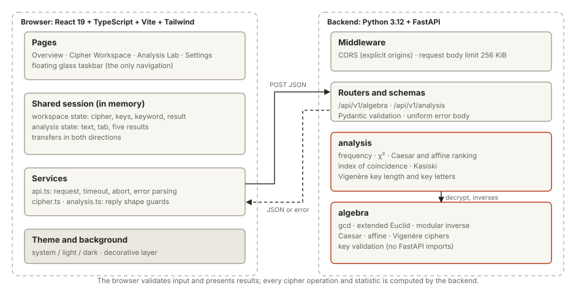

* **Frontend** (React 19, TypeScript, Vite, Tailwind CSS 4): pages, one shared session that survives navigation, services that call
  the API and check the shape of each reply. No cryptography runs in the browser.
* **Backend** (FastAPI): an `algebra` package (gcd, extended Euclid, modular inverse, the three ciphers) and an `analysis` package
  (frequencies, χ², index of coincidence, Kasiski, Vigenère investigation). The mathematics never imports FastAPI.
* **API**: JSON over HTTP under `/api/v1`, one uniform error body that never echoes the input, a 256 KiB body limit.

Read more: [architecture overview](docs/architecture/overview.md) · [data flow](docs/architecture/data-flow.md) ·
[design system](docs/architecture/design-system.md).

## Technology stack

| Layer | Technology |
| --- | --- |
| Frontend | React 19, TypeScript (strict), Vite 8, Tailwind CSS 4, React Router, Lucide icons; Space Grotesk, Inter and IBM Plex Mono, self-hosted |
| Backend | Python 3.12, FastAPI, Uvicorn, Pydantic |
| Testing | pytest, httpx, SymPy (independent oracle, tests only); Vitest, Testing Library, jsdom |

## Worked examples

**Encryption and decryption** (all verified by the test suite and by running the application):

| Cipher | Key | Plaintext | Ciphertext |
| --- | --- | --- | --- |
| Caesar | k = 3 | `Hello, World!` | `Khoor, Zruog!` |
| Affine | a = 5, b = 8 | `AFFINE CIPHER` | `IHHWVC SWFRCP` |
| Vigenère | `LEMON` | `ATTACKATDAWN` | `LXFOPVEFRNHR` |

Affine by hand: `A = 0` gives `5·0 + 8 = 8 = I`; `F = 5` gives `5·5 + 8 = 33 ≡ 7 = H`. To decrypt, 5⁻¹ ≡ 21 (mod 26) because
5 · 21 = 105 = 4 · 26 + 1.

**Statistical analysis.** A 126-letter English sentence enciphered with a Caesar shift of 3:

| Measurement | Result |
| --- | --- |
| most frequent ciphertext letters | `H`, `W`, `D` (English leads with `E`, `T`, `A`) |
| Caesar ranking by χ² | k = 3 scores 21.7; the runner-up, k = 2, scores 332.2 |
| index of coincidence | 0.0665, unchanged by the cipher, so English-like |

**Vigenère recovery.** A 459-letter English passage encrypted with the key `LEMON`: IC 0.0426 (flat), Kasiski best-supported
length 5 (30 of 32 repeat distances), mean column IC 0.0687 at length 5 against about 0.043 for the other short lengths, suggested
length 5, best candidate key `LEMON` with the original text recovered. The experiment and its limits are in the
[project report](docs/report/PROJECT_REPORT.md#11-testing-and-verification).

## Mathematical foundations

Letters are numbers in ℤ₂₆ (`A = 0 … Z = 25`). An affine multiplier needs an inverse, which exists exactly when gcd(a, 26) = 1:
there are 12 such multipliers, hence 12 × 26 = 312 keys. The inverse comes from the extended Euclidean algorithm, written by hand
and checked against SymPy. ℤ₂₆ is not a field. Frequency analysis ranks keys by Pearson's χ² statistic against English letter
frequencies, and the index of coincidence and Kasiski examination estimate a repeating key's length.

| Note | Topic |
| --- | --- |
| [Caesar and affine](docs/mathematics/caesar-and-affine.md) | modular arithmetic, gcd, extended Euclid, inverses, the two ciphers |
| [Vigenère](docs/mathematics/vigenere.md) | the cipher and its worked example |
| [Frequency analysis](docs/mathematics/frequency-analysis.md) | English reference, χ², key ranking |
| [Polyalphabetic analysis](docs/mathematics/polyalphabetic-analysis.md) | index of coincidence, Kasiski, key recovery |

## Installation

Prerequisites: **Python 3.12+**, **Node.js 20.19+ or 22.12+**, **npm** and **Git**.

```powershell
git clone https://github.com/Samudra-GITHub/discreta.git
cd discreta

# backend
cd backend
python -m venv .venv
.\.venv\Scripts\Activate.ps1
python -m pip install -r requirements-dev.txt

# frontend
cd ..\frontend
npm install
Copy-Item .env.example .env
```

On macOS or Linux activate the virtual environment with `source .venv/bin/activate`. Full details, environment variables and
troubleshooting: [development setup](docs/development/setup.md).

## Running locally

Use two terminals.

```powershell
# terminal 1, from backend/ with the virtual environment active
uvicorn app.main:app --reload --port 8000

# terminal 2, from frontend/
npm run dev
```

Open <http://localhost:5173>. Interactive API documentation is at <http://localhost:8000/docs>. The frontend must stay on port
5173 because the backend allows only that origin (and 4173, for `npm run preview`) through CORS; set `DISCRETA_CORS_ORIGINS` to
allow others.

## Testing

```powershell
# backend, from backend/ with the virtual environment active
python -m pytest

# frontend, from frontend/
npm run build     # type-check and production build
npm test
```

Release v1.0.0 was verified with 1,410 backend tests and 262 frontend tests, a clean type-check and production build, and browser
checks at 375, 768, 1024 and 1440 px in both themes against the real backend (see [testing](docs/development/testing.md)).

## Documentation

| | |
| --- | --- |
| [Documentation index](docs/README.md) | where everything is |
| [User guide](docs/user-guide.md) | encrypt, decrypt, analyse, interpret the results |
| [Project report](docs/report/PROJECT_REPORT.md) · [PDF](docs/report/DISCRETA_Project_Report.pdf) | the academic report |
| [Executive summary](docs/report/EXECUTIVE_SUMMARY.md) | one page |
| [API reference](docs/api.md) | endpoints, limits, errors |
| [Architecture](docs/architecture/overview.md) · [data flow](docs/architecture/data-flow.md) | how it is built |
| [Mathematics](docs/mathematics/README.md) | the theory with worked examples |

## Limitations and security disclaimer

> **These ciphers are not secure.** Caesar, affine and Vigenère are historical and educational. They must never protect real
> data. DISCRETA exists to show why they are easy to break, not to provide encryption.

* **Estimates, not proof.** Every ranking is statistical. Short texts, non-English text and unusual English (a pangram, for
  example) can mislead it; reliability flags say so.
* **English reference only**, from a single average frequency table.
* **Vigenère recovery** needs roughly 25 or more letters per key letter; **Kasiski** finds nothing for a short text or a long key.
* **Only three ciphers.** No Playfair, Hill, transposition or modern ciphers.
* **Limits:** text up to 10,000 characters, Vigenère keywords up to 64 letters, keys up to ±(2⁵³ − 1), request bodies up to 256 KiB.

The full list is in the [project report](docs/report/PROJECT_REPORT.md#13-limitations).

## Team BugSquad

DISCRETA is built by team **BugSquad**, two people:

* **Samudra Kar** ([@Samudra-GITHub](https://github.com/Samudra-GITHub)), repository owner: software implementation, tests
  and documentation
* **Shriyanshu Rout Roy**: mathematics research and review, the formulas and references behind the ciphers and the statistics

Released under the [MIT License](LICENSE).

Acknowledgements: the frequency reference is the table in Lewand's *Cryptological Mathematics*; the method names honour
Kasiski, Friedman and Pearson. The full bibliography is in the [project report](docs/report/PROJECT_REPORT.md#15-references).
