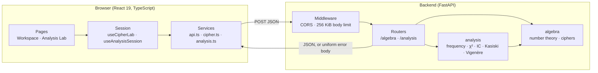
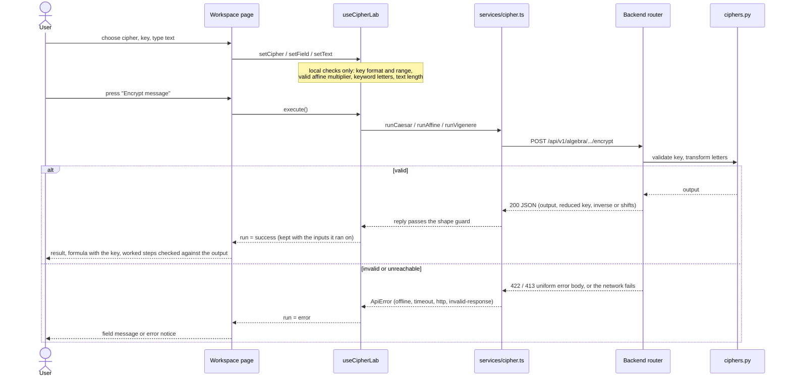
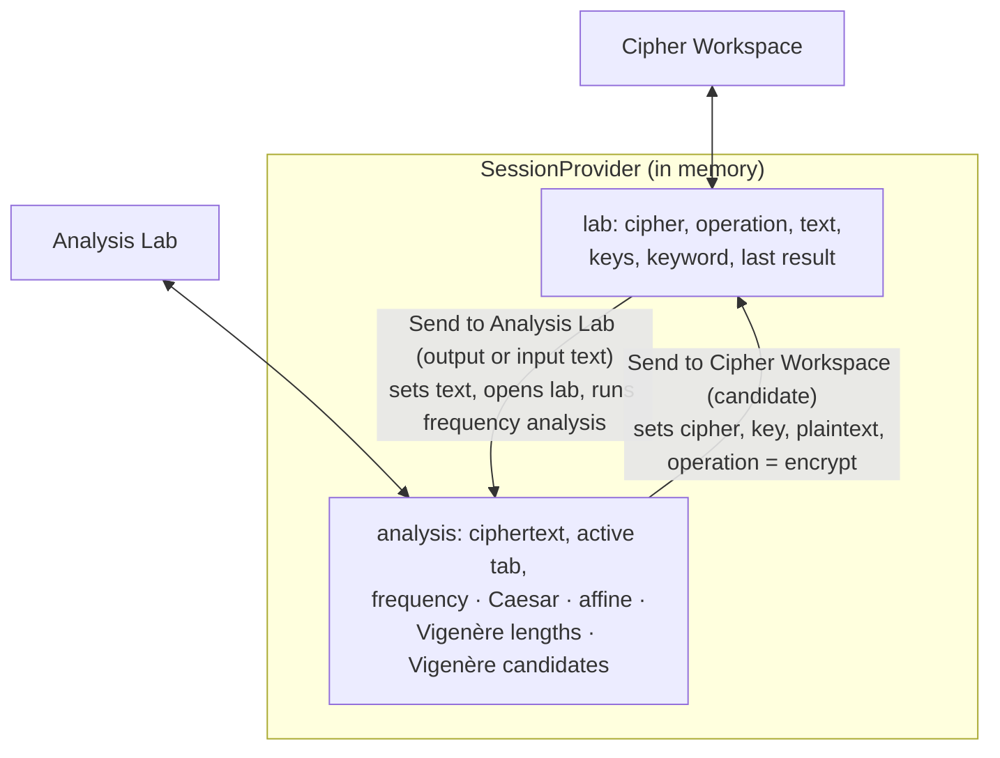
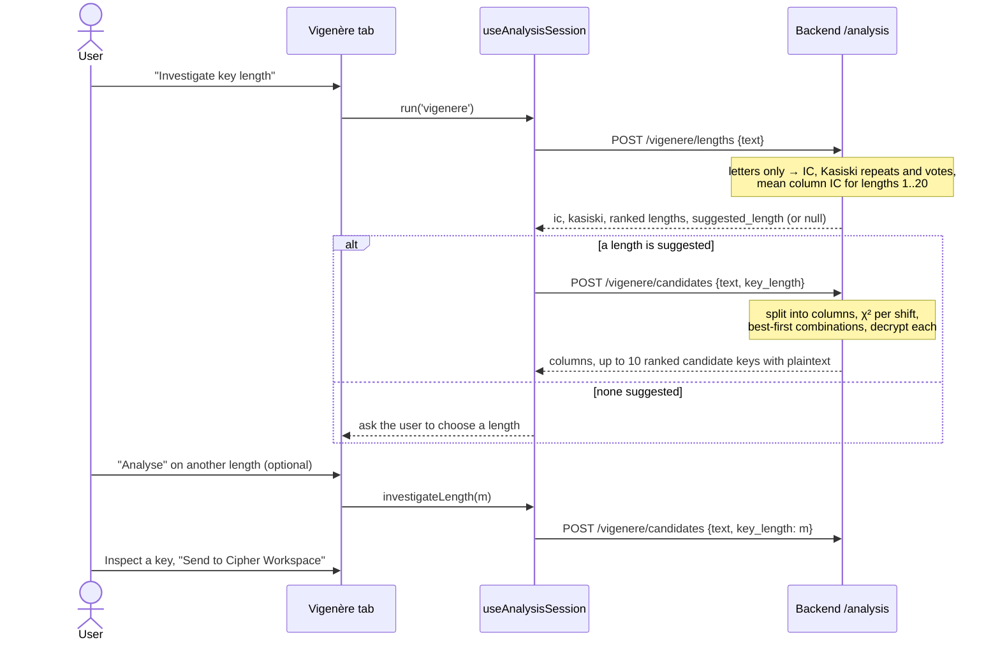

# Data flow

How data moves through DISCRETA: from a button press in the browser to the backend's mathematics and back, and between the
Cipher Workspace and the Analysis Lab. The diagrams are [Mermaid](https://mermaid.js.org/), which GitHub renders; static SVG
versions used by the report are in [`../report/figures/`](../report/figures/). Module structure is in the
[overview](overview.md).

## 1. Layers

* The browser never encrypts, decrypts or computes statistics. It validates what the user typed, calls the backend, checks the
  **shape** of each reply, and presents it.
* `analysis` calls `algebra` for decryption and modular inverses; it has no cipher arithmetic of its own.
* Both packages keep their mathematics free of FastAPI, so the routers only translate requests and errors.

## 2. One encryption

Rules enforced by the hook:

* **Explicit action only.** Typing never calls the backend.
* **Newest request wins.** A new call aborts an older one.
* **Results belong to their inputs.** If the inputs change after a run, the result stays visible but is marked *out of date*
  and no longer fills in numbers (for example the inverse) for different keys.

## 3. The shared session

The workspace and the lab are different pages but one investigation, so their state lives above the routes in
`SessionProvider` and survives navigation. Nothing is persisted: closing the tab ends it.

| Transfer | What is set |
| --- | --- |
| Workspace → Analysis Lab | the analysis text becomes the chosen text; the tab becomes *Frequency Analysis*; the frequency analysis runs |
| Analysis Lab → Workspace | cipher and key from the candidate (Caesar `key`; affine `a`, `b`; Vigenère `shortest_equivalent_key`), the candidate's plaintext as the message, operation *encrypt* |
| Clear (lab) | text and all five results are emptied, tab returns to Frequency |
| Clear session (Settings) | the workspace returns to its initial inputs and the lab is cleared |

Each analysis stores the text it ran on. If the text differs from the current one the result is shown as *out of date*.

## 4. The Vigenère investigation

## 5. Errors and limits

Every client error has one shape, `{"detail": [{"loc", "msg", "type"}]}`, never echoes the input, and lists at most 20
problems. The frontend turns it into one of these states:

| Situation | Backend | Frontend |
| --- | --- | --- |
| backend not running | no response | "The backend is not reachable" with the start command |
| no answer in time | timeout (5 s; 15 s for the affine search and Vigenère calls) | "took too long" |
| invalid field | 422 with `loc` | the message appears next to that field |
| body too large | 413 | "The message is too large" |
| unexpected reply | 200 with a different shape | "Unexpected reply from the backend"; nothing is shown |

## 6. Theme and navigation

* **Navigation** is one floating taskbar with four links (`navItems` in `layouts/navigation.ts`); there is no sidebar or top bar.
  Old addresses `/cipher-lab` and `/frequency-analyzer` redirect to the new pages; any other unknown path shows a not-found page.
* **Theme** is held by `ThemeProvider`: a choice of system, light or dark stored in `localStorage` (failures ignored), mirrored on
  `<html data-theme>`, applied before first paint by an inline script, and following the operating system live while *system*
  is selected.
* **Background** is a decorative fixed layer behind the page: `pointer-events: none`, hidden from assistive technology, paused in a
  hidden tab and static under reduced motion. See the [design system](design-system.md).
