<div class="cover">

# DISCRETA

## Classical Cryptography and Frequency Analysis Laboratory

**Project report**

| | |
| --- | --- |
| **Team** | BugSquad: Samudra Kar and Shriyanshu Rout Roy |
| **Version** | 1.0.0 |
| **Release** | commit `b54f570`, tag `v1.0.0`, 26 November 2026 |
| **Repository** | <https://github.com/Samudra-GITHub/discreta> |
| **Repository owner** | Samudra Kar (GitHub: Samudra-GITHub) |
| **Development period** | 25 to 26 November 2026, from the repository history |
| **Licence** | MIT |

*Every figure and example in this report was checked against the repository, the test suite or a run of the application.
Institution and supervisor details are not given because the project material does not record them.*

</div>

<div class="page-break"></div>

## Contents

1. [Abstract](#1-abstract)
2. [Introduction](#2-introduction)
3. [Problem statement](#3-problem-statement)
4. [Objectives](#4-objectives)
5. [Scope](#5-scope)
6. [System architecture](#6-system-architecture)
7. [Mathematical foundations](#7-mathematical-foundations)
8. [Algorithm design](#8-algorithm-design)
9. [Implementation](#9-implementation)
10. [User workflow](#10-user-workflow)
11. [Testing and verification](#11-testing-and-verification)
12. [Results and discussion](#12-results-and-discussion)
13. [Limitations](#13-limitations)
14. [Conclusion](#14-conclusion)
15. [References](#15-references)

[Appendix A: reproducing the experiments](#appendix-a-reproducing-the-experiments) ·
[Appendix B: API summary](#appendix-b-api-summary) ·
[Appendix C: repository layout](#appendix-c-repository-layout)

<div class="page-break"></div>

## 1. Abstract

Classical ciphers are the standard first subject of cryptography courses, but they are usually studied on paper, where the
arithmetic is slow and the statistical attacks that defeat them are hard to observe. DISCRETA is a web application that
combines the two in one laboratory. It implements three classical ciphers, the Caesar, affine and Vigenère ciphers, with
encryption and decryption, and a set of statistical analysis tools: letter-frequency analysis against an English reference,
Pearson's χ² statistic, ranking of all 26 Caesar keys and all 312 valid affine keys, the index of coincidence, Kasiski
examination, and a Vigenère investigation that ranks candidate key lengths, estimates each key letter and proposes ranked
candidate keys.

The system has a React 19 and TypeScript frontend and a Python FastAPI backend. All cryptographic and statistical computation
is done by the backend, with the number theory (gcd, extended Euclidean algorithm, modular inverse) written from scratch; the
frontend validates input, calls the API and presents the results. A shared in-memory session lets a result move from the
Cipher Workspace to the Analysis Lab and a candidate move back. Every analysis is labelled as measured, calculated or a
suggestion, carries a reliability flag for short texts, and is never presented as proof.

The implementation was verified against textbook vectors, brute-force definitions and independently written reference
implementations: 1,410 backend tests and 262 frontend tests pass, and the interface was checked in a browser against the real
backend at four screen widths in light and dark themes. In a representative experiment a 459-letter ciphertext encrypted with the
key `LEMON` yielded an index of coincidence of 0.0426, a suggested key length of 5, and the recovered key `LEMON`. The report
also documents the limits of the method honestly: short texts, non-English text and long keys defeat it.

**Keywords:** classical cryptography, Caesar cipher, affine cipher, Vigenère cipher, frequency analysis, chi-squared statistic,
index of coincidence, Kasiski examination, modular arithmetic.

## 2. Introduction

### 2.1 Classical cryptography

Classical cryptography covers the ciphers that were used before computers, from the shift cipher attributed to Julius Caesar to
the polyalphabetic ciphers of the sixteenth century onward. They are *substitution* ciphers: each letter of the message is
replaced by another according to a key. A **monoalphabetic** cipher, such as the Caesar and affine ciphers, uses one fixed
replacement for the whole message. A **polyalphabetic** cipher, such as the Vigenère cipher, switches between several
replacements, which was long believed to make it unbreakable [Kahn, 1996; Singh, 1999].

### 2.2 Why they matter academically

These ciphers are weak, and that is exactly their value. They are small enough to analyse completely, and they make abstract
mathematics concrete: Caesar's cipher is addition in ℤ₂₆; the affine cipher needs multiplication to be invertible, which is the
condition gcd(a, 26) = 1 and leads to the extended Euclidean algorithm and modular inverses; the Vigenère cipher is a repeating
sequence of Caesar shifts. They also introduce the central lesson of cryptanalysis: a cipher that hides *which* letter is which
may still leak *how often* each letter occurs [Stinson and Paterson, 2018; Stallings, 2017].

### 2.3 Why frequency analysis is useful

A monoalphabetic cipher only relabels letters, so the *multiset* of letter counts is preserved: in English text `E`, `T` and
`A` are the most common letters, and in the ciphertext the same counts appear attached to different letters. Comparing the
ciphertext's distribution with a reference distribution therefore recovers the key. The comparison can be made precise with
Pearson's χ² statistic [Pearson, 1900], and the same idea, applied to every *m*-th letter, attacks the Vigenère cipher once its
key length is known. The index of coincidence [Friedman, 1922] and Kasiski examination [Kasiski, 1863] estimate that length.

### 2.4 Why an interactive laboratory

On paper, a student can encrypt a sentence but rarely attacks a 400-letter ciphertext, because counting letters and trying 312
affine keys by hand is impractical. An interactive laboratory removes the drudgery without hiding the method: the formula that
applies to the current key is shown, the first steps are worked out, every candidate key can be inspected, and the statistics
behind each suggestion are visible. The student can encrypt something, attack it, and see exactly when and why the attack
succeeds or fails.

## 3. Problem statement

Existing resources for classical cryptography tend to be of two kinds: static explanations with worked examples, and
single-purpose tools (a Caesar wheel, a frequency counter, a Vigenère solver). A student who wants to *encrypt a message, then
attack it with the statistics a cryptanalyst would use, and check the result* has to move between tools, retype text, and trust
code they cannot inspect. Tools also often present a ranking as an answer, without showing its uncertainty.

DISCRETA addresses the need for **one unified application** that

* performs classical cipher operations correctly, with validated keys and clear errors;
* applies standard statistical cryptanalysis to the ciphertext, with every step inspectable;
* keeps measured facts, calculated values and statistical suggestions visibly separate and flags unreliable results;
* connects the two, so a ciphertext moves between encryption and analysis without retyping, and a candidate decryption can be
  sent back to be re-encrypted as a check.

## 4. Objectives

The objectives as realised in version 1.0.0:

1. Implement the Caesar, affine and Vigenère ciphers, with encryption and decryption, mathematically correct and independently
   verified.
2. Implement the supporting number theory (gcd, extended Euclidean algorithm, modular inverse) from first principles, and use
   it for the affine cipher.
3. Implement statistical analysis: letter frequencies, English comparison and the χ² statistic.
4. Rank all 26 Caesar keys and all 312 valid affine keys.
5. Implement the index of coincidence and Kasiski examination, and use them to investigate the key length of a Vigenère
   cipher, estimate its key letters and propose ranked candidate keys.
6. Keep the backend the single source of truth for every cryptographic and statistical calculation.
7. Present the tools in a focused interface in which the workspace and the analysis lab share one session.
8. Be honest: label every result as measured, calculated or suggested, flag short texts, and state the limits.
9. Document the mathematics, the architecture, the API and the user workflow, and verify them against the code.

## 5. Scope

### 5.1 In scope

| Area | Supported |
| --- | --- |
| Ciphers | Caesar, affine, Vigenère: encryption and decryption |
| Alphabet | the 26 ASCII letters; case preserved; other characters copied unchanged |
| Frequency analysis | letter counts, relative frequencies, ranks, comparison with an English reference, χ² |
| Key ranking | all 26 Caesar keys and all 312 valid affine keys, ranked by χ² |
| Polyalphabetic analysis | index of coincidence, Kasiski examination, Vigenère key-length ranking, key-letter estimation, candidate keys |
| Interface | Cipher Workspace, Analysis Lab, Settings, Overview; light, dark and system themes; responsive from 375 px |

### 5.2 Out of scope

Modern cryptography (AES, RSA and similar), other classical ciphers (Playfair, Hill, transposition, one-time pad), languages other than English,
user accounts, persistence, and any use of the ciphers to protect real information. **DISCRETA is for classical cryptography and
academic experimentation. It is not a means of secure communication**, and the Caesar, affine and Vigenère ciphers are not secure
encryption.

## 6. System architecture

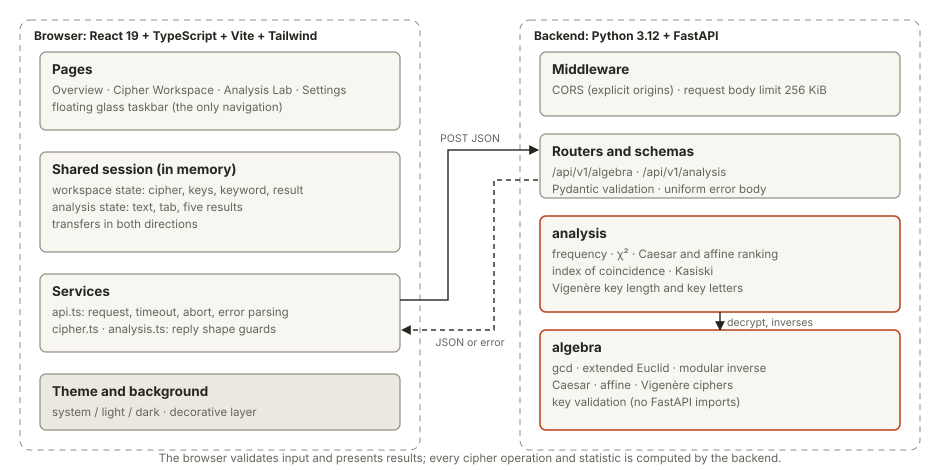

*Figure 1. The React frontend sends JSON over HTTP to the FastAPI backend. The browser performs no cryptography.*

### 6.1 Overview

DISCRETA is a monorepo with a **frontend** (React 19, TypeScript, Vite 8, Tailwind CSS 4) and a **backend** (Python 3.12, FastAPI).
They communicate only through a versioned JSON API under `/api/v1`. The frontend is a single-page application served by Vite; the
backend is stateless and holds no data between requests.

### 6.2 Backend

The backend is organised as one package per concern, each exposing a router:

| Package | Responsibility |
| --- | --- |
| `algebra` | `number_theory.py` (gcd, extended Euclid, modular inverse); `ciphers.py` (Caesar, affine, Vigenère, key validation); `schemas.py` and `router.py` |
| `analysis` | `english.py` (reference table); `scoring.py` (χ²); `frequency.py`; `cryptanalysis.py` (Caesar and affine ranking); `coincidence.py` (index of coincidence); `kasiski.py`; `vigenere_analysis.py`; `schemas.py` and `router.py` |
| `core` | settings, the uniform error handlers, the request-size limit |

The *cryptographic engine* (`algebra`) and the *analysis engine* (`analysis`) never import FastAPI, so the mathematics can be tested
directly. `analysis` calls `algebra` for decryption and inverses and contains no cipher arithmetic of its own. The routers translate
requests into calls on these functions and turn expected failures into one uniform error body,
`{"detail": [{"loc", "msg", "type"}]}`, which never echoes the input, is plain ASCII and lists at most 20 problems. Unexpected exceptions
return a generic 500. Middleware rejects request bodies over 256 KiB before parsing (413), and CORS allows explicit origins only.

### 6.3 Frontend

The frontend has four destinations reached from one floating glass taskbar (Overview, Cipher Workspace, Analysis Lab, Settings);
there is no sidebar and no dashboard. Its parts:

| Part | Role |
| --- | --- |
| Pages | Overview, Workspace, Analysis Lab (four tabs: Frequency, Caesar, Affine, Vigenère), Settings |
| Session | `SessionProvider` holds the workspace state (`useCipherLab`) and the analysis state (`useAnalysisSession`) above the routes |
| Services | `api.ts` (request, timeout, abort, error parsing), `cipher.ts` and `analysis.ts` (one function per endpoint, each checking the shape of the reply) |
| Theme | `ThemeProvider`: system, light or dark, stored in `localStorage`, applied before first paint |
| Background | a decorative fixed layer: `pointer-events: none`, hidden from assistive technology, paused in a hidden tab, static under reduced motion |

The browser validates what the user types (key format and range, a valid affine multiplier, keyword letters, text length) and presents
the backend's answers; it computes no ciphertext, count or statistic. The only local arithmetic is presentation: reducing a key modulo 26,
explaining why a multiplier is invalid, and a worked example that is cross-checked letter by letter against the backend's output and hidden
if anything disagrees.

### 6.4 Moving results between the workspace and the lab

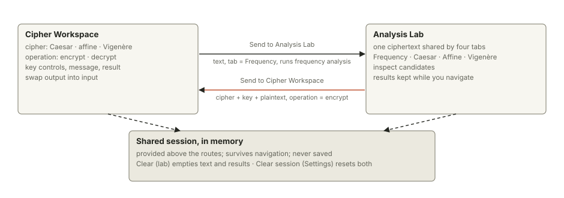

*Figure 2. A result moves to the Analysis Lab; a candidate moves back, set to encrypt.*

The workspace and the lab are two pages but one investigation, so their state lives in one in-memory session that survives navigation
and is never saved. **Send to Analysis Lab** sets the analysis text, opens the lab and runs the frequency analysis. **Send to Cipher
Workspace** on a candidate fills the workspace with the candidate's plaintext, cipher and key, and the *encrypt* operation, so running it
reproduces the original ciphertext, which checks that the candidate is consistent. Each analysis result remembers the text it was run
on; if the text has since changed the result stays visible, marked *out of date*.

### 6.5 Request handling and errors

Typing never calls the backend; only a button does, and a newer request aborts an older one. Failures reach the user in specific forms: an
unreachable backend (with the start command), a timeout, a field-level message for a 422, a size message for a 413, and a refusal to show
a reply of the wrong shape. A further description with sequence diagrams is in [`architecture/data-flow.md`](../architecture/data-flow.md).

## 7. Mathematical foundations

Letters are identified with numbers in ℤ₂₆: `A = 0, B = 1, …, Z = 25`. All arithmetic is modulo 26. Only the 52 ASCII letters are
enciphered, case is preserved, and every other character is copied unchanged [Stinson and Paterson, 2018; Rosen, 2019].

### 7.1 Caesar cipher

```
Encryption:  E(x) = (x + k) mod 26
Decryption:  D(y) = (y − k) mod 26
```

The key `k` is any integer; it is reduced modulo 26, so there are 26 distinct keys. Decryption inverts encryption because
`((x + k) − k) mod 26 = x`.

*Example, k = 3:* `Hello, World!` becomes `Khoor, Zruog!`.

| Letter | H | e | l | l | o | W | o | r | l | d |
| --- | --- | --- | --- | --- | --- | --- | --- | --- | --- | --- |
| x | 7 | 4 | 11 | 11 | 14 | 22 | 14 | 17 | 11 | 3 |
| x + 3 mod 26 | 10 | 7 | 14 | 14 | 17 | 25 | 17 | 20 | 14 | 6 |
| Cipher | K | h | o | o | r | Z | r | u | o | g |

### 7.2 Greatest common divisor and the extended Euclidean algorithm

The Euclidean algorithm computes `gcd(a, b)` by repeated division: `gcd(a, b) = gcd(b, a mod b)`, ending at `gcd(g, 0) = g` [Knuth, 1997].
The *extended* algorithm also returns integers `x, y` with `a·x + b·y = g` (Bézout's identity).

*Example, gcd(5, 26):*

```
26 = 5·5 + 1
 5 = 1·5 + 0          so gcd(5, 26) = 1
Back-substitute:  1 = 26 − 5·5 = 5·(−5) + 26·1       so x = −5, y = 1
```

The implementation returns `(1, −5, 1)` for `(5, 26)`.

### 7.3 Modular inverse

`a` has a multiplicative inverse modulo `n` exactly when `gcd(a, n) = 1`. If `a·x + n·y = 1` then `a·x ≡ 1 (mod n)`, so the inverse of `a`
is `x mod n`. For `a = 5`, `n = 26`: `x = −5 ≡ 21`, and indeed `5 · 21 = 105 = 4 · 26 + 1`. The code computes inverses with the extended
algorithm only (SymPy appears in the tests as an independent check, never in the application).

ℤ₂₆ is **not a field**: of its 25 non-zero elements, 13 have no inverse (the even numbers 2 to 24, and 13), so only 12 residues are invertible.

### 7.4 Affine cipher and its valid multipliers

```
Encryption:  E(x) = (a·x + b) mod 26
Decryption:  D(y) = a⁻¹ · (y − b) mod 26,   where a·a⁻¹ ≡ 1 (mod 26)
Validity:    gcd(a, 26) = 1
```

Encryption is a bijection of ℤ₂₆ exactly when `a` is invertible. If `gcd(a, 26) = g > 1`, then `x = 0` and `x = 26/g` encrypt to the same
letter, because `a · 26/g = (a/g) · 26 ≡ 0`; decryption would be ambiguous. The multipliers modulo 26 with `gcd(a, 26) = 1` are the
**12** values

| a | 1 | 3 | 5 | 7 | 9 | 11 | 15 | 17 | 19 | 21 | 23 | 25 |
| --- | --- | --- | --- | --- | --- | --- | --- | --- | --- | --- | --- | --- |
| a⁻¹ | 1 | 9 | 21 | 15 | 3 | 19 | 7 | 23 | 11 | 5 | 17 | 25 |

and with 26 offsets `b` give **12 × 26 = 312** valid keys (φ(26) = 12). For `a = 4`, `gcd(4, 26) = 2`, so `A` (0) and `N` (13) both encrypt
to `b`; the interface explains an invalid multiplier with exactly such a pair and never sends it.

*Example, a = 5, b = 8:* `A = 0 → 5·0 + 8 = 8 = I`; `F = 5 → 5·5 + 8 = 33 ≡ 7 = H`; `I = 8 → 48 ≡ 22 = W`; `N = 13 → 73 ≡ 21 = V`;
`E = 4 → 28 ≡ 2 = C`. Hence `AFFINE` becomes `IHHWVC`, and `AFFINE CIPHER` becomes `IHHWVC SWFRCP`. To decrypt `I`:
`21 · (8 − 8) = 0 = A`.

### 7.5 Vigenère cipher

A Vigenère key is a keyword of `m` letters, read as shifts `K₀ … K_{m−1}`. With `i` counting only the *letters* of the message,

```
Encryption:  Cᵢ = (Pᵢ + K_{i mod m}) mod 26
Decryption:  Pᵢ = (Cᵢ − K_{i mod m} + 26) mod 26
```

Spaces, digits and punctuation are copied and do **not** use up a key letter, so the keyword stays aligned with the letters. With `m = 1`
the cipher is the Caesar cipher; each of the `m` key positions is a separate Caesar cipher applied to every `m`-th letter. There are `26ᵐ` keys.

*Example, key `LEMON` = (11, 4, 12, 14, 13), message `ATTACKATDAWN`:*

| Pᵢ | A 0 | T 19 | T 19 | A 0 | C 2 | K 10 | A 0 | T 19 | D 3 | A 0 | W 22 | N 13 |
| --- | --- | --- | --- | --- | --- | --- | --- | --- | --- | --- | --- | --- |
| key | L 11 | E 4 | M 12 | O 14 | N 13 | L 11 | E 4 | M 12 | O 14 | N 13 | L 11 | E 4 |
| Pᵢ + Kᵢ | 11 | 23 | 31 | 14 | 15 | 21 | 4 | 31 | 17 | 13 | 33 | 17 |
| mod 26 | 11 | 23 | 5 | 14 | 15 | 21 | 4 | 5 | 17 | 13 | 7 | 17 |
| Cᵢ | L | X | F | O | P | V | E | F | R | N | H | R |

So `ATTACKATDAWN` becomes `LXFOPVEFRNHR`. The four `A`s become `L`, `O`, `E` and `N`: single-letter frequencies are flattened.

### 7.6 Frequency distributions

For a text with letter counts `Oᵢ` (`i = 0 … 25`) and `N = Σ Oᵢ` letters, the *relative frequency* of letter `i` is `Oᵢ / N`. Only ASCII
letters count, case is ignored, and spaces, digits, punctuation and non-ASCII characters are ignored. The English reference is the table in
Lewand [2000] (E 12.702 %, T 9.056 %, A 8.167 %, … Z 0.074 %). As printed, its 26 values sum to 99.999 %, so they are *normalised* to
probabilities `pᵢ` with `Σ pᵢ = 1`. Monoalphabetic ciphers preserve the multiset of counts, which is why the distribution leaks the key.

### 7.7 The χ² statistic

For `N` letters, the expected count of letter `i` in English text is `Eᵢ = N · pᵢ`, and

```
χ² = Σᵢ (Oᵢ − Eᵢ)² / Eᵢ          (26 letters, 25 degrees of freedom)
```

Observed and expected values are both *counts*. A sample drawn at random from English has `E[χ²] ≈ 25` (the degrees of freedom); much larger
values mean the letters are not distributed like English [Pearson, 1900]. χ² *ranks* candidates; it is not the probability that a candidate is
correct.

*Hand-checkable example:* for observed `[10, 20]` against probabilities `[½, ½]`, `N = 30`, `E = (15, 15)` and
`χ² = (10−15)²/15 + (20−15)²/15 = 50/15 ≈ 3.33`.

### 7.8 Ranking Caesar and affine keys

Decrypting with the right key restores English letter counts; a wrong key does not. The Caesar search scores every key `k = 0 … 25` and the
affine search every one of the 312 valid keys `(a, b)`, sorting by χ² (lowest first). The score is computed from the ciphertext's letter counts
alone (decrypting with `k` makes the plaintext count of letter `x` equal the ciphertext count of letter `(x + k) mod 26`) and is cross-checked
in the tests against the χ² of the really decrypted text.

### 7.9 Index of coincidence

```
IC = Σᵢ fᵢ (fᵢ − 1) / (N (N − 1))
```

This is the probability that two *different* randomly chosen positions of the text hold the same letter [Friedman, 1922]. For English, `IC ≈ Σ pᵢ² = 0.0655`;
for uniformly random letters, `IC = 1/26 = 0.0385`. *Example:* `HELLO WORLD` has `L = 3`, `O = 2` and five letters once, `N = 10`: `Σ fᵢ(fᵢ−1) = 6 + 2 = 8`
and `IC = 8/90 = 0.0889`. With fewer than two letters the IC is undefined and the system reports that, never NaN.

A monoalphabetic cipher does not change the IC; a polyalphabetic cipher pushes it towards 0.0385. The system reads an IC of 0.060 or more as
*english-like*, 0.045 or less as *flat*, and between as *intermediate*; these thresholds are heuristics and the IC is evidence, not proof. Friedman's rough
estimate of a repeating key's length is `m ≈ (κp − κr) N / ((N − 1) IC − κr N + κp)` with `κp = 0.0655`, `κr = 1/26`.

### 7.10 Kasiski examination

If a plaintext fragment occurs at two positions a multiple of the key length `m` apart, it enciphers to the same ciphertext fragment. So the distance
between two occurrences of a repeated ciphertext sequence is often a multiple of `m` [Kasiski, 1863]. Positions are counted among the letters from 0.

*Example:* in `ABCXYZABCQRSTABC` the sequence `ABC` is at positions 0, 6 and 13, giving repeat distances 6 (0 to 6), 13 (0 to 13) and 7 (6 to 13). The
distance 6 is divisible by 2, 3 and 6, so those key lengths each get one vote; 7 and 13 are prime and vote only for themselves; the gcd of all distances is 1.
Every multiple of the true key length collects the same votes, and chance repeats short sequences, so the votes are evidence about the length, not a verdict.

### 7.11 Vigenère key-length analysis

For each candidate length `m` from 1 to 20, the letters are split into `m` columns (letter `i` goes to column `i mod m`) and the IC of each column is averaged
into the **mean IC**. At the true length each column is a single Caesar cipher of English, so the mean IC is near 0.0655; at other lengths it is near 0.043.
A length is *plausible* if its mean IC is at least 0.055 and within 0.005 of the best in the table. Multiples of the true length are plausible too, so plausible
lengths are listed shortest first and the first is *suggested*.

For a chosen length, each column is a Caesar cipher, and its key letter is the shift with the smallest column χ². Candidate keys are the best combinations of the best three
shifts per column, ranked by the sum of the column χ² values, and each candidate is also scored by the whole-text χ² of its decryption as an independent check.

## 8. Algorithm design

### 8.1 Cipher operations

`_map_letters` (Caesar, affine) and `_vigenere` walk the text once, transform only ASCII letters and copy everything else. Key validation raises a
typed error that the router turns into a 422 `invalid_key` with the offending field, never echoing the key or the text.

```
vigenere(text, shifts, direction):
    index ← 0
    for each character c in text:
        if c is an ASCII letter:
            c' ← (c − base + direction · shifts[index mod |shifts|]) mod 26 + base   # base = 'A' or 'a'
            index ← index + 1
        else:
            c' ← c                                   # copied, key does not advance
        output c'
```

### 8.2 Evaluating and ranking candidate keys

```
rank_caesar(ciphertext):
    counts ← letter counts of ciphertext;  N ← sum(counts)
    if N = 0: error "no letters"
    for k in 0..25:
        plain_counts[x] ← counts[(x + k) mod 26]
        score[k] ← χ²(plain_counts, English)
    sort k by (score[k], k);  attach decrypt(ciphertext, k) and a reliability flag from N

rank_affine(ciphertext):                    # all 312 valid keys, never an invalid one
    for a in valid multipliers; b in 0..25:
        a_inv ← mod_inverse(a, 26)
        plain_counts[a_inv·(y − b) mod 26] += counts[y]   for every letter y
        score[(a, b)] ← χ²(plain_counts, English)
    sort by (score, a, b)
```

Ties are broken by key, so the order is deterministic. Reliability is *very low*, *low* or *adequate* from the number of letters (Caesar: below 20 and below
60; affine, which must tell 312 keys apart: below 50 and below 150). These thresholds are heuristics for teaching, not statistical constants.

### 8.3 Vigenère investigation

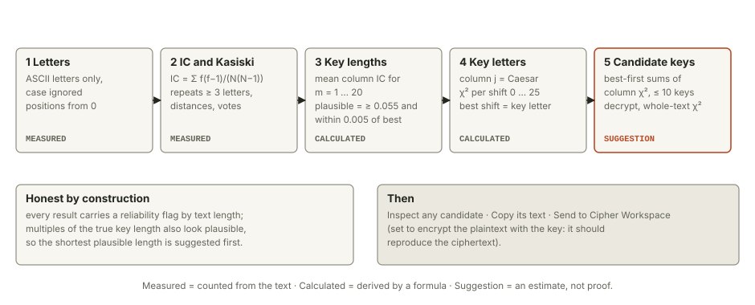

*Figure 3. From letters to candidate keys, with each stage labelled measured, calculated or suggestion.*

```
investigate_lengths(text):                       # POST /analysis/vigenere/lengths
    letters ← ASCII letters, upper-case;  need N ≥ 2
    ic ← IC(letters);  reading ← classify(ic);  friedman ← estimate(ic, N)
    repeats ← kasiski_repeats(letters);  votes ← per length 2..40, how many repeat distances it divides
    for m in 1..min(20, N/2):  mean_ic[m] ← average IC of the m columns
    plausible ← { m : mean_ic[m] ≥ 0.055 and mean_ic[m] ≥ max(mean_ic) − 0.005 }
    suggested ← min(plausible) if plausible else none

analyse_key_length(text, m):                      # POST /analysis/vigenere/candidates
    for each column j: scores ← χ² of the column decrypted with each shift 0..25
                       best ← argmin;  keep the best 3 shifts and runner-up / best
    candidates ← up to 10 lowest sums of column χ² (best-first search over the kept shifts)
    for each candidate: decrypt the whole text, record the whole-text χ²
    shortest_equivalent_key ← shortest keyword whose repetition gives the key
```

Kasiski repeats are found by pairing each trigram with up to its 8 most recent earlier occurrences, keeping a pair only if it does not also match one letter to the
left, and measuring its length to the right up to 20 letters; the work is linear in the text length.

### 8.4 Measured, calculated and suggested

| Kind | Meaning | Examples |
| --- | --- | --- |
| **Measured** | counted directly from the text | letter counts, repeated sequences and their positions, the IC value |
| **Calculated** | derived from measurements by a formula | χ², mean column IC, the Kasiski votes |
| **Suggestion** | a statistical estimate | the ranked Caesar and affine keys, the suggested key length, candidate Vigenère keys |

The interface carries these labels, and the API returns a reliability flag and a plain-language note with every ranking.

## 9. Implementation

### 9.1 Backend

The backend exposes eleven operational endpoints (six cipher endpoints, five analysis endpoints) plus a health check, a module list and a service banner;
the reference is in [`api.md`](../api.md) and summarised in Appendix B. Requests and replies are Pydantic models with strict types:
keys are strict integers within ±(2⁵³ − 1), the largest integer a browser represents exactly, texts are limited to 10,000 characters, Vigenère keywords to 64 letters, and
bodies to 256 KiB. `extra` fields are rejected. FastAPI generates the OpenAPI schema, including the 413 and 422 error responses, at `/docs`.

### 9.2 Validation and error handling

| Situation | Response |
| --- | --- |
| a key that is mathematically invalid (affine `a` with `gcd(a, 26) ≠ 1`, a keyword with a digit) | 422 `invalid_key`, located at the key field |
| a key search over a text without letters | 422 `no_letters` |
| too little text for a Vigenère investigation (fewer than two letters) | 422 `insufficient_text` |
| a Vigenère key length larger than the number of letters | 422 `invalid_key_length` |
| a malformed body, wrong types, unknown fields, over-long text | 422 with the validation location |
| a body over 256 KiB | 413 `payload_too_large` |
| an unexpected exception | 500 with a fixed generic body; the traceback goes only to the server log |

Input is never echoed in an error, `NaN`, `Infinity` and unpaired surrogates in a request cannot cause a 500, and responses are plain ASCII.

### 9.3 Frontend

The Cipher Workspace shows, for the chosen cipher and operation, only the controls and formula that apply. Caesar has a numeric field (negative and very large values
accepted and shown reduced) with a slider; affine offers the 12 valid multipliers as buttons and explains an invalid one with a colliding pair of letters; Vigenère has a keyword
field and a line showing how the keyword repeats over the letters. The result panel shows the output, a summary of the key used, the first three letters worked out and checked, and the actions
*Copy output*, *Swap into input* and *Send to Analysis Lab*. Results are used only while they match the current inputs.

The Analysis Lab has one shared ciphertext box and four tabs. The frequency tab shows the counts as a chart with the expected English value marked on each letter, a difference chart, a
plain-language reading and a ranked table. The Caesar and affine tabs rank their keys and offer an inspector for any candidate. The Vigenère tab shows the IC on a scale, the Kasiski evidence,
the key-length chart and table, the key letters and the candidate keys. Charts are SVG built from the backend's numbers only, each with a text description, and every table has a caption.

### 9.4 Screenshots

Captured from the running application against the real backend (`docs/report/screenshots-v1.0.0/`).

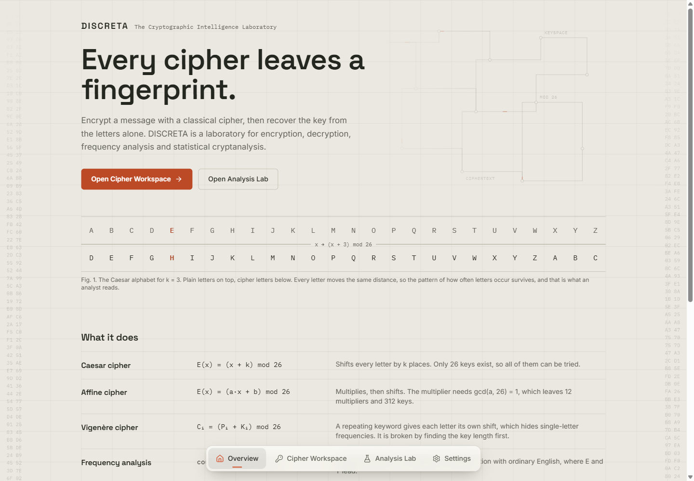

*Figure 4. Overview, light theme.*

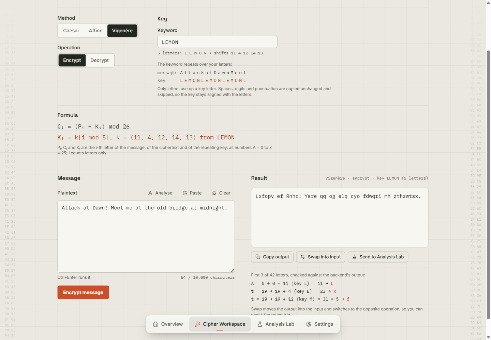

*Figure 5. Cipher Workspace: Vigenère encryption of `Attack at Dawn! Meet me at the old bridge at midnight.` with the keyword `LEMON`.*

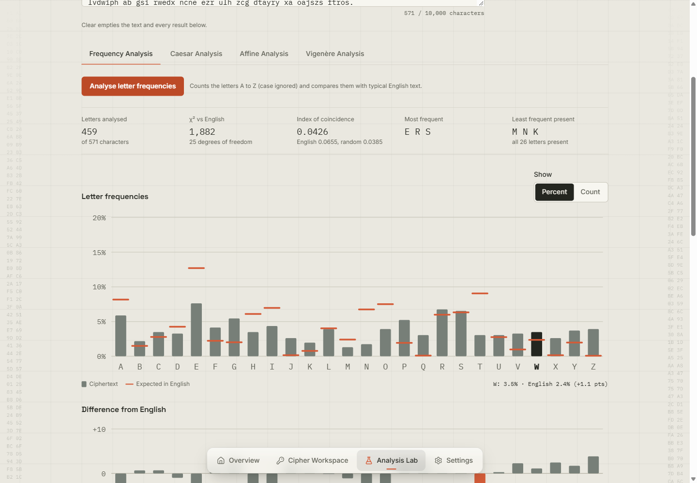

*Figure 6. Frequency analysis: ciphertext percentages with the expected English value marked on each letter.*

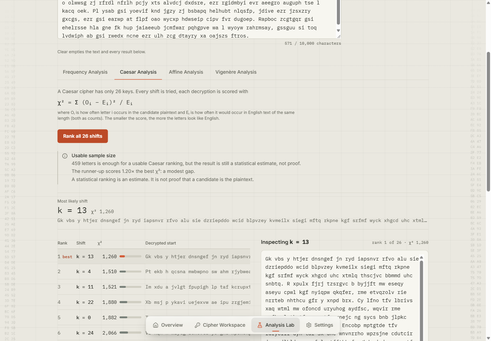

*Figure 7. Caesar analysis: the 26 shifts ranked by χ², with the best candidate inspected.*

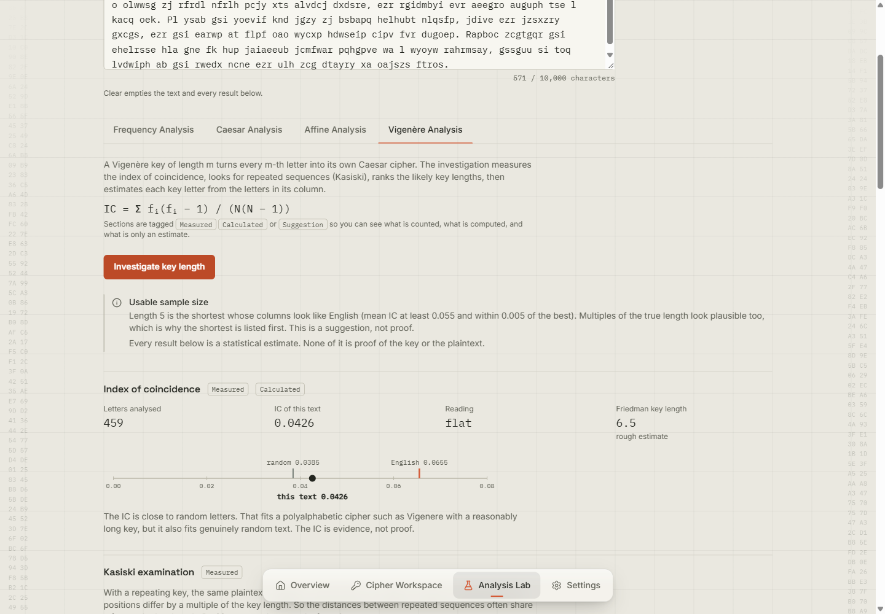

*Figure 8. Vigenère analysis: the index of coincidence between the random and English values.*

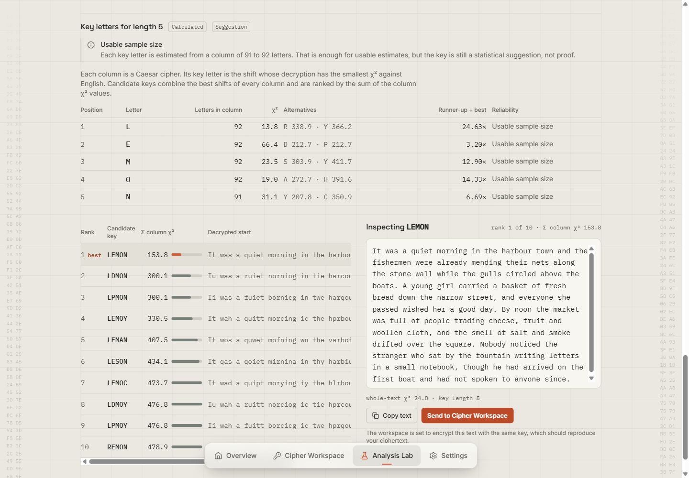

*Figure 9. Vigenère analysis: key letters for length 5 and the ranked candidate keys; the best is `LEMON`.*

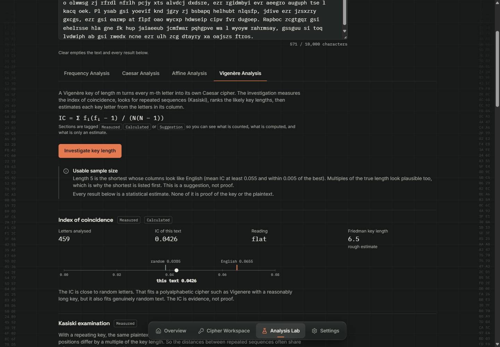

*Figure 10. The same analysis in the dark theme.*

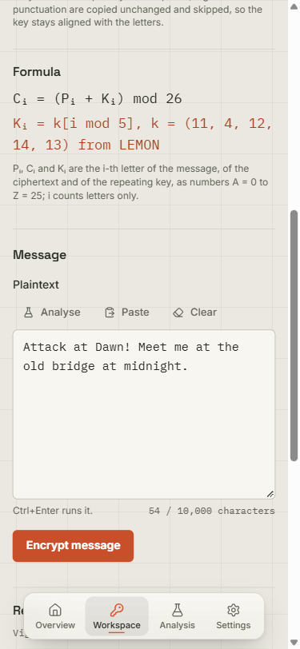

*Figure 11. The Cipher Workspace at 375 px with the floating taskbar.*

## 10. User workflow

1. **Encrypt.** In the Cipher Workspace choose a cipher, set its key, type a message and press *Encrypt message*. The formula with the key filled in and the first steps are shown.
2. **Decrypt.** Choose *Decrypt* with the same key; *Swap into input* checks a round trip.
3. **Analyse.** Press *Send to Analysis Lab*: the lab opens with the ciphertext and has run the frequency analysis.
4. **Attack a monoalphabetic cipher.** In the Caesar or Affine tab rank the keys, inspect the top candidates and read their decryptions.
5. **Investigate a polyalphabetic cipher.** In the Vigenère tab press *Investigate key length*: read the IC, the Kasiski evidence and the key-length table, choose a length if none is suggested, and inspect the candidate keys.
6. **Check a candidate.** *Send to Cipher Workspace* sets the workspace to encrypt the candidate's plaintext with its key; reproducing the ciphertext confirms the candidate.

The complete walk-through, with the interpretation of each result, is in the [user guide](../user-guide.md).

## 11. Testing and verification

### 11.1 Method

The mathematics is verified against **independent** expected values, not against the code that produced a result: textbook vectors as literals, a separately written reference implementation
(plain `ord`/`chr`), brute-force definitions of the index of coincidence and of repeated sequences, exact arithmetic with `fractions`, `collections.Counter` for letter counts, `math.gcd` and
`pow(a, -1, 26)`, and SymPy for number theory only. Where the space is small the checks are exhaustive (all 26 × 26 letter pairs, all 312 affine keys); the Vigenère investigation is checked over seeded random
keys. Limits are tested too: a pangram defeating the affine ranking, two-letter texts misleading the Caesar ranking, short ciphertexts being flagged.

### 11.2 Results

The suites were re-run for this report on 26 November 2026, immediately before the report was finalised, with no application source changed since the v1.0.0 release.

| Check | Command | Result |
| --- | --- | --- |
| Backend tests | `python -m pytest` (in `backend/`) | **1,410 passed** |
| Frontend tests | `npm test` (in `frontend/`) | **262 passed**, 13 test files |
| TypeScript | `tsc -b` | clean, no errors |
| Production build | `npm run build` | clean; main JavaScript 364.23 kB (112.41 kB gzipped), CSS 36.22 kB (8.51 kB gzipped) |

The release verification recorded in the repository also covered a browser run of the real application against the real backend: all four destinations and all four analysis tabs,
in light and dark themes, at 375, 768, 1024 and 1440 px, with no horizontal overflow, no console error and no failed request, and a scripted audit finding every button, input, tab and chart
named and every table captioned. That browser check is a manual, scripted procedure and was not repeated for this report.

### 11.3 Representative verification examples

| Cipher | Key | Plaintext | Ciphertext |
| --- | --- | --- | --- |
| Caesar | k = 3 | `Hello, World!` | `Khoor, Zruog!` |
| Affine | a = 5, b = 8 | `AFFINE CIPHER` | `IHHWVC SWFRCP` |
| Vigenère | `LEMON` | `ATTACKATDAWN` | `LXFOPVEFRNHR` |

Further textbook checks: Vigenère `CRYPTOISSHORTFORCRYPTOGRAPHY` with `ABCD` gives `CSASTPKVSIQUTGQUCSASTPIUAQJB`; the decryption formula `(C − K + 26) mod 26` holds for all 676 letter pairs; a one-letter
Vigenère key equals the Caesar cipher for every shift.

### 11.4 Caesar and affine ranking experiments

*Caesar.* The 126-letter sentence *Meet me at the old bridge at midnight. Bring the documents, and tell no one! The guards change at dawn, so we must leave before the sun comes up over the harbour.* was
enciphered with k = 3. Its most frequent ciphertext letters are `H`, `W`, `D`; the χ² against English of the 26 decryptions is 21.7 for k = 3 and 332.2 for the runner-up k = 2 (a ratio of 15.28), so the
correct key leads clearly. The ciphertext's IC is 0.0665, the same as English text, as expected for a monoalphabetic cipher.

*Affine.* Enciphering a 126-letter English passage with (a, b) = (5, 8) gives χ² 20.5 for the true key and 126.2 for the runner-up (11, 12). The response correctly carries a *low* reliability flag, because
126 letters is below the 150 the affine search needs.

### 11.5 Vigenère recovery experiment

A 459-letter English passage (`LONG_PASSAGE` in `backend/tests/passages.py`, written for the project) was encrypted with the key `LEMON` and analysed:

| Measurement | Result |
| --- | --- |
| index of coincidence | **0.0426**, reading *flat* (random is 0.0385, English 0.0655) |
| Friedman key-length estimate | about 6.5 (rough) |
| Kasiski examination | 32 repeated sequences; key length 5 divides 30 of their distances (2 and 10 divide 18) |
| mean column IC | **0.0687 at length 5**, 0.0678 at 10; 0.0418 to 0.0441 at the other lengths 1 to 9 |
| suggested key length | **5** |
| key letters (columns of 91 to 92 letters) | `L`, `E`, `M`, `O`, `N`, each with a runner-up χ² 3 to 25 times the best |
| best candidate | **`LEMON`** (column χ² sum 153.8, whole-text χ² 24.8); the original text is recovered |

The next candidates are `LDMON` and `LPMON` (column sum 300.1) and `LEMOY` (330.5), all clearly worse. In a seeded statistical check, the suggested length equalled the true key length for all 288 random keys of 1
to 12 letters on two English passages, and the best candidate equalled the true key for all 192 random keys when the right length was supplied.

*Caveat.* These passages are two English texts written for the project; the result shows the method works on ordinary English of this length, not that it works on arbitrary text.

### 11.6 Documented failures

The tests assert, rather than hide, the cases where the method fails: a pangram uses every letter about equally, so the true affine key is not ranked first for any of the 312 keys; two-letter texts defeat the Caesar ranking
for most keys; a Vigenère key length that is wrong, or a text too short for its columns, produces wrong candidates that are flagged as unreliable.

## 12. Results and discussion

The completed system meets its objectives: three ciphers, verified against independent oracles; a complete set of statistical tools from letter counts to Vigenère candidate keys; a unified interface in which an encryption can
be attacked and the attack checked; and documentation that matches the code.

**What the experiments show.** For a monoalphabetic cipher the letter-frequency method is decisive given enough text: the correct Caesar key beat the runner-up by more than a factor of fifteen on a 126-letter sentence. For the
Vigenère cipher the two statistics complement each other. The IC alone only says *flat* (consistent with a polyalphabetic cipher or random text), Kasiski alone is biased towards divisors and multiples and chance repeats, but the
mean column IC shows a sharp peak at the true length, and once the length is known the problem reduces to five independent Caesar problems, which χ² solves reliably on columns of about 90 letters.

**What the design adds.** Labelling each result as measured, calculated or suggested, attaching a reliability flag to every ranking, and showing the alternatives beside the winner (runner-up scores, the whole candidate list) are meant to teach
the *epistemics* of cryptanalysis as well as the algorithms: a ranking is evidence, and how much it is worth depends on how much text there is. Separating the backend (all mathematics) from the frontend (validation and presentation) made
the mathematics directly testable, and the worked example that is hidden when it disagrees with the backend is a small guard against the interface ever explaining something that did not happen.

**What the system does not show.** It does not show that the heuristic thresholds (plausible mean IC, the reliability limits) are optimal; they are chosen for teaching and validated only on the passages described above. It does not
address ciphers outside the three, or text that is not English.

## 13. Limitations

1. **The English reference.** The χ² and IC comparisons use one average English table (Lewand, normalised). A particular passage can deviate from it, especially a short one, and a text in another language, or unusual English such as a
   pangram, can be ranked wrongly. No other language is supported.
2. **Statistical ranking is uncertain.** Every ranking is an estimate. χ² orders candidates; it is not a probability of correctness, and the top candidate can be wrong. The interface says so beside every ranking.
3. **Short ciphertexts.** With few letters the counts are noisy: two-letter texts mislead the Caesar ranking for most keys, and the affine search needs more text than the Caesar search because it must tell 312 keys apart. Results carry a
   reliability flag (very low, low, adequate) from the number of letters, but the thresholds are heuristics.
4. **Vigenère recovery has requirements.** It assumes a repeating keyword and English plaintext, and needs roughly 25 or more letters per key letter before a key letter can be trusted; with fewer, the candidates are guesses. A key as long as
   the text approaches a one-time pad, which the method cannot break. The suggested length is the shortest plausible one and may be wrong; multiples of the true length also look plausible.
5. **Kasiski limitations.** Kasiski needs repeated sequences, so it finds nothing for a short text or a long key; chance repeats short sequences; and every multiple of the true key length collects the same votes. It is evidence, not a verdict.
6. **The index of coincidence is a hint.** It separates monoalphabetic from polyalphabetic patterns only roughly, and below about 100 letters it is noisy. The reading thresholds (0.060 and 0.045) are heuristics.
7. **Only three ciphers.** Caesar, affine and Vigenère; no Playfair, Hill, transposition or modern cipher, and only the 26 ASCII letters are enciphered.
8. **Classical ciphers are not secure.** They are broken here in milliseconds. DISCRETA studies why; it must never be used to protect real information.
9. **Evaluation corpus.** The verification of the Vigenère investigation uses two English passages written for the project and seeded random keys, not an independent corpus.
10. **API limits.** Texts up to 10,000 characters, Vigenère keywords up to 64 letters, keys within ±(2⁵³ − 1) and bodies up to 256 KiB are transport limits, not mathematical ones.

## 14. Conclusion

DISCRETA delivers what it set out to: a focused laboratory in which a student can encrypt with the Caesar, affine and Vigenère ciphers and then attack the result with letter frequencies, χ², the index of coincidence and Kasiski
examination, with the backend as the single, independently verified source of every calculation. Its academic value lies in making the connection between the arithmetic of ℤ₂₆ (gcd, inverses, the condition gcd(a, 26) = 1) and the statistics that
break the ciphers visible and inspectable, while being honest about uncertainty.

### Team

DISCRETA was built by the two members of team BugSquad. **Samudra Kar**, the repository owner, carried out the software implementation, the tests and the documentation.
**Shriyanshu Rout Roy** contributed the mathematics research and review: the formulas, definitions and references that the ciphers and the statistical methods in this report rest on.

**Possible future extensions** (none of which exist in version 1.0.0): further classical ciphers and their attacks (for example Playfair, Hill, transposition), reference frequencies for other languages, a
larger and independent evaluation corpus for the Vigenère thresholds, and exporting an analysis session.

## 15. References

Citations in the text use the author–year form.

Friedman, W. F. (1922). *The Index of Coincidence and Its Applications in Cryptography* (Publication No. 22). Riverbank Laboratories.

Kahn, D. (1996). *The Codebreakers: The Comprehensive History of Secret Communication from Ancient Times to the Internet* (Rev. ed.). Scribner.

Kasiski, F. W. (1863). *Die Geheimschriften und die Dechiffrir-Kunst*. E. S. Mittler und Sohn.

Katz, J., & Lindell, Y. (2020). *Introduction to Modern Cryptography* (3rd ed.). CRC Press.

Knuth, D. E. (1997). *The Art of Computer Programming, Volume 2: Seminumerical Algorithms* (3rd ed.). Addison-Wesley.

Lewand, R. E. (2000). *Cryptological Mathematics*. Mathematical Association of America.

Pearson, K. (1900). On the criterion that a given system of deviations from the probable in the case of a correlated system of variables is such that it can be reasonably supposed to have arisen from random sampling.
*Philosophical Magazine*, Series 5, 50(302), 157–175.

Rosen, K. H. (2019). *Discrete Mathematics and Its Applications* (8th ed.). McGraw-Hill Education.

Singh, S. (1999). *The Code Book: The Evolution of Secrecy from Mary, Queen of Scots, to Quantum Cryptography*. Doubleday.

Stallings, W. (2017). *Cryptography and Network Security: Principles and Practice* (7th ed.). Pearson.

Stinson, D. R., & Paterson, M. B. (2018). *Cryptography: Theory and Practice* (4th ed.). CRC Press.

*Technical documentation* (consulted for the implementation): FastAPI, <https://fastapi.tiangolo.com>; Pydantic, <https://docs.pydantic.dev>; React, <https://react.dev>; Vite, <https://vite.dev>;
Tailwind CSS, <https://tailwindcss.com>.

---

## Appendix A: reproducing the experiments

From `backend/` with the virtual environment active:

```powershell
python -c "from app.modules.algebra.ciphers import *; print(caesar_encrypt('Hello, World!', 3), affine_encrypt('AFFINE CIPHER', 5, 8), vigenere_encrypt('ATTACKATDAWN', 'LEMON'))"
```

prints `Khoor, Zruog! IHHWVC SWFRCP LXFOPVEFRNHR`. The Vigenère experiment of section 11.5:

```powershell
python -c "
from tests.passages import LONG_PASSAGE
from app.modules.algebra.ciphers import vigenere_encrypt
from app.modules.analysis import vigenere_analysis as va
ct = vigenere_encrypt(LONG_PASSAGE, 'LEMON')
a = va.analyse_lengths(ct)
print(round(a.ic.ic, 4), a.suggested_length, a.kasiski.total_repeats, [(v.length, v.repeats) for v in a.kasiski.votes[:3]])
c = va.analyse_key_length(ct, 5)
print([(x.key, round(x.column_chi_sum, 1)) for x in c.candidates[:2]])
"
```

prints `0.0426 5 32 [(5, 30), (2, 18), (10, 18)]` and `[('LEMON', 153.8), ('LDMON', 300.1)]`. The tests are run with `python -m pytest` and `npm test`.

## Appendix B: API summary

Base URL `http://localhost:8000`; interactive documentation at `/docs`. All operations are `POST` with a JSON body; see [`api.md`](../api.md) for limits and errors.

| Endpoint | Body | Purpose |
| --- | --- | --- |
| `/api/v1/algebra/caesar/encrypt`, `/decrypt` | `{"text", "key"}` | Caesar cipher |
| `/api/v1/algebra/affine/encrypt`, `/decrypt` | `{"text", "a", "b"}` | affine cipher; 422 `invalid_key` unless `gcd(a, 26) = 1` |
| `/api/v1/algebra/vigenere/encrypt`, `/decrypt` | `{"text", "key"}` | Vigenère cipher; keyword of 1 to 64 letters |
| `/api/v1/analysis/frequency` | `{"text"}` | counts, shares, ranks, English comparison, χ², IC |
| `/api/v1/analysis/caesar/crack` | `{"text"}` | 26 ranked keys |
| `/api/v1/analysis/affine/search` | `{"text", "plaintext_limit"?}` | 312 ranked keys |
| `/api/v1/analysis/vigenere/lengths` | `{"text"}` | IC, Kasiski, ranked key lengths, suggestion |
| `/api/v1/analysis/vigenere/candidates` | `{"text", "key_length"}` | key letters and ranked candidate keys |

## Appendix C: repository layout

```text
discreta/
├── backend/app/{api, core, modules/{algebra, analysis}}   FastAPI service
├── backend/tests/                                          pytest suite
├── frontend/src/{components, layouts, modules, pages, services, session, theme}
├── docs/{architecture, mathematics, development, report}, api.md, user-guide.md
└── README.md · LICENSE (MIT)
```
